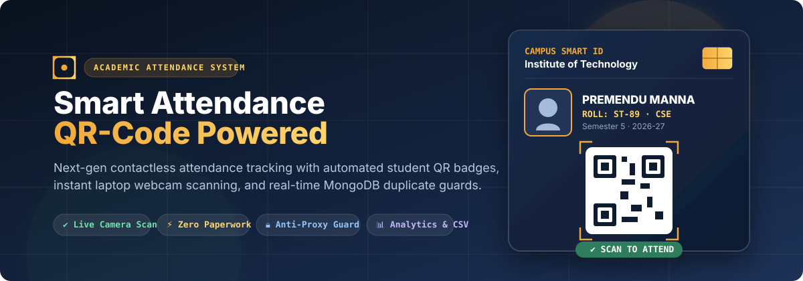
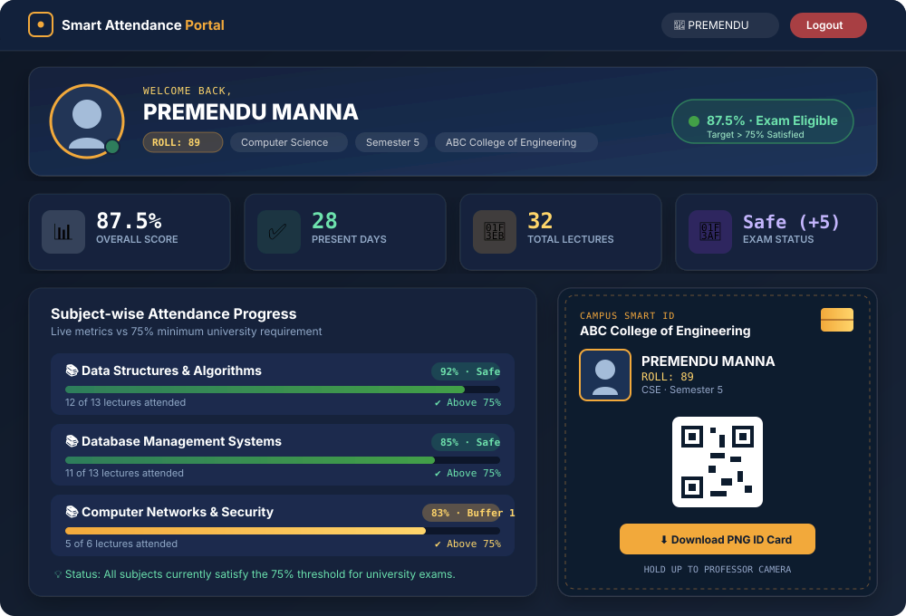
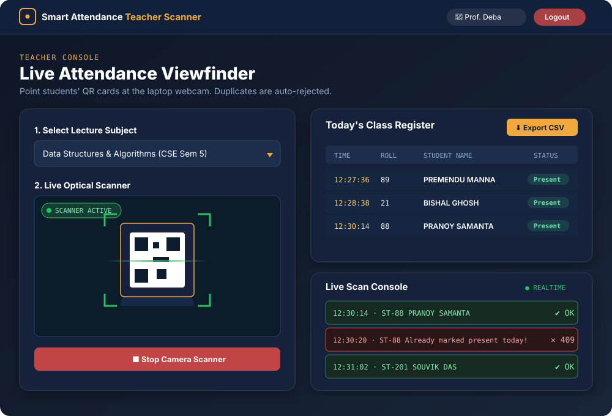
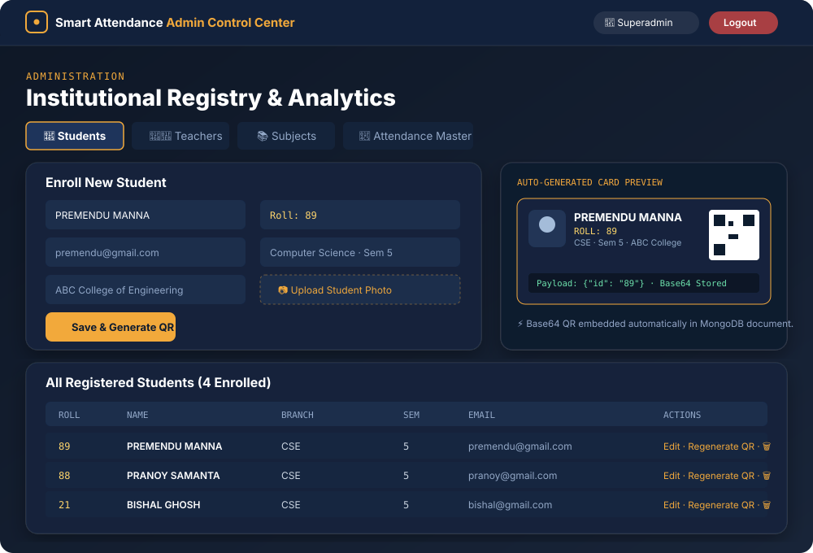
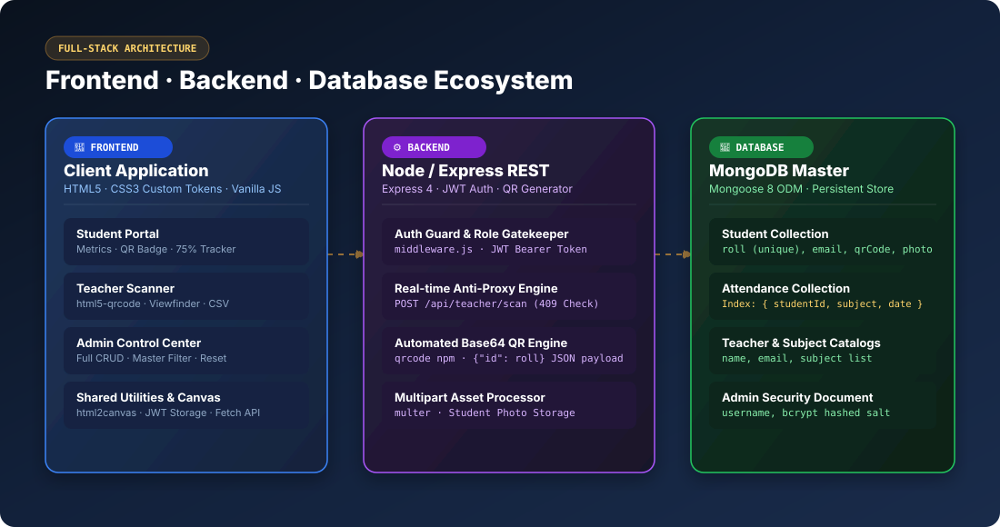

# 🎓 QR Code Based Smart Attendance System

<div align="center">



[](https://nodejs.org/)
[](https://expressjs.com/)
[](https://www.mongodb.com/)
[](https://developer.mozilla.org/en-US/docs/Web/JavaScript)
[](https://jwt.io/)
[](https://github.com/mebjas/html5-qrcode)
[](LICENSE)

<p align="center">
  <strong>A modern, full-stack contactless attendance tracking platform designed for colleges and universities.</strong><br>
  Eliminate paper rosters and proxy roll calls with real-time camera scanning, automated digital student ID badges, and atomic MongoDB duplicate prevention.
</p>

[Explore Portals](#-interactive-portals--website-previews) •
[Frontend Architecture](#-frontend-architecture--portals) •
[Backend Architecture](#-backend-architecture--apis) •
[API Reference](#-api-specification--endpoints) •
[Local Setup](#-installation--local-setup) •
[GitHub Upload Guide](#-how-to-upload-this-project-to-github)

</div>

---

## 📌 Executive Overview

Traditional classroom roll-call methods are slow, waste valuable lecture time, and are easily exploited through proxy attendance. **Smart Attendance System** modernizes this workflow into a frictionless, 3-second routine:

1. **Institutions / Admins** enroll students and teachers. Each student automatically receives a unique **Campus Smart QR ID Card**.
2. **Students** log into their personalized portal to download high-resolution PNG badges, monitor their real-time attendance percentage, and track the mandatory **75% university exam eligibility**.
3. **Teachers** launch the live webcam viewfinder on any laptop, select their subject, and scan student cards. Attendance is verified and saved to the database in sub-seconds with strict anti-duplicate protection.

---

## 🖼️ Interactive Portals & Website Previews

### 1. 🎓 Student Dashboard & Digital Smart ID
The student portal provides an intuitive, data-driven interface where students can track their academic standing, subject-wise attendance percentages, and download their official digital campus ID badge.



- **Dynamic Greeting & Profile Summary:** Displays student name, roll number, academic branch, semester, and institution.
- **Attendance Health Indicator:** Real-time badge computing whether the student satisfies the **75% threshold** (`Exam Eligible ✅` vs `Attendance Warning ⚠️`).
- **Target & Buffer Tracker:** Accurately computes how many consecutive classes a student can safely miss or must attend to attain exam qualification.
- **Subject-wise Progress Bars:** Visual color-coded progress bars (Green $\ge 75\%$, Amber $60\text{--}74\%$, Red $< 60\%$) with exact attendance ratios.
- **Digital Campus Smart ID:** High-definition ID badge with embedded base64 QR code, student photo, holographic smart-chip accent, and 1-click **Download PNG** or **Print** actions.
- **Searchable Attendance Log:** Instant client-side search across past attendance records by subject, date, or timestamp.

---

### 2. 👨‍🏫 Teacher Live Camera Scanner
The teacher portal transforms any standard laptop webcam or mobile device camera into an optical barcode attendance terminal.



- **Lecture Configuration:** Select registered subjects and section/semester with automatic schedule detection.
- **Optical Camera Viewfinder:** Powered by `html5-qrcode` with an environmental scanning frame, targeting reticle, and laser guide.
- **Duplicate-Scan Guard:** Immediate visual and acoustic feedback. If a card is scanned twice for the same lecture on the same day, a `409 Conflict` warning is triggered and rejected.
- **Live Class Register:** Real-time table updating instantly as students pass by the camera.
- **1-Click CSV Export:** Download comprehensive lecture registers directly to Microsoft Excel or Google Sheets.

---

### 3. 👑 Admin Control Center
A centralized administrative dashboard providing complete control over institutional records, academic catalogs, and data audits.



- **Student Management:** Full CRUD operations with student photograph uploads (`multer`), academic categorization, and on-demand QR code regeneration.
- **Teacher Directory:** Create teacher accounts, assign specific departmental subjects, and manage access credentials.
- **Subject Catalog:** Maintain institutional courses mapped to branches and semesters.
- **Granular Attendance Filtering:** Filter historical logs by Subject, Date (`YYYY-MM-DD`), and Academic Branch.
- **Scope-based Attendance Reset:** Safely clear filtered records or perform end-of-semester data purges.

---

## 🎨 Frontend Architecture & Portals

The frontend is intentionally built with high-performance vanilla web standards (**HTML5**, **CSS3**, and **Vanilla ES6+ JavaScript**), ensuring zero build step friction, instant page loads, and long-term maintainability.

```
SmartAttendance/public/
├── index.html        # Public landing hero & role selection gateway
├── login.html        # Multi-role authentication portal (Student / Teacher / Admin tabs)
├── student.html      # Comprehensive student analytics dashboard & ID card generator
├── teacher.html      # Real-time webcam viewfinder & lecture attendance logger
├── admin.html        # Institutional management suite (CRUD, catalog, filter, purge)
├── style.css         # Central design system (CSS tokens, dark mode gradients, cards)
├── script.js         # Shared client utilities (JWT session storage, API fetch wrapper)
└── uploads/          # Static file server directory
    ├── photos/       # Uploaded student identification headshots
    └── qrcodes/      # Legacy directory (QR codes are stored in DB as Base64 data URLs)
```

### Key Frontend Capabilities
1. **Bespoke Design System (`style.css`):**
   - Cohesive campus theme combining deep navy (`#12213B`), signal amber (`#F2A93B`), and crisp data typography (`JetBrains Mono` + `Inter`).
   - Reusable components: Glassmorphic hero headers, responsive metric grids, interactive progress bars, pill badges, and printable campus ID cards.
2. **Client-Side Optical Scanning (`html5-qrcode`):**
   - Utilizes device video streams directly in the browser without sending raw video feeds over the network.
   - Decodes QR payloads in memory and submits lightweight JSON verification requests to the API.
3. **High-DPI Canvas ID Card Export (`html2canvas`):**
   - Converts the client-rendered DOM ID card into a 300 DPI, lossless PNG download.
4. **Protected Routing & Session Persistence:**
   - Stateless JWT tokens stored in `localStorage` (`sa_token`, `sa_role`, `sa_name`).
   - Automatic route interception via `requireRole("student" | "teacher" | "admin")`.

---

## ⚙️ Backend Architecture & APIs

The backend is built on **Node.js** and **Express.js**, adhering to RESTful API conventions with strict role-based access control and atomic database transactions.



### Backend Technology Stack
- **Runtime:** Node.js (v18.x or v20.x recommended)
- **Web Framework:** Express.js 4.19
- **Database:** MongoDB with Mongoose 8 ODM
- **Authentication:** JSON Web Tokens (`jsonwebtoken`) + `bcrypt` password hashing (10 salt rounds)
- **QR Code Engine:** Server-side `qrcode` module converting JSON roll identifiers into base64 Data URLs
- **Multipart Uploads:** `multer` disk storage with MIME-type filtering for student profile photos

### Core Business Logic & Security Guarantees
1. **Lightweight QR Lookup Payload:**
   - The QR code does not contain vulnerable PII (personally identifiable information). It only encodes a minimal lookup key:
     ```json
     { "id": "ST101" }
     ```
   - When scanned, the server performs the identity lookup, ensuring attendance credentials cannot be spoofed.
2. **Atomic Duplicate-Scan Prevention:**
   - In addition to application-level checks, attendance uniqueness is guaranteed at the database level via a **MongoDB compound unique index**:
     ```javascript
     attendanceSchema.index({ studentId: 1, subject: 1, date: 1 }, { unique: true });
     ```
   - Scanning the same student for the same subject on the same calendar day returns an HTTP `409 Conflict`, completely preventing accidental or intentional double-scans.
3. **Role-Based Access Guard (`middleware.js`):**
   - Every protected API endpoint checks the `Authorization: Bearer <token>` header, verifies the signature against `JWT_SECRET`, and enforces the user's role before executing business logic.

---

## 📋 API Specification & Endpoints

### 🔐 Authentication (`/api/auth`)
| Method | Endpoint | Access | Description | Request Body |
|---|---|---|---|---|
| `POST` | `/api/auth/student/login` | Public | Student email/password login | `{ "email": "...", "password": "..." }` |
| `POST` | `/api/auth/teacher/login` | Public | Teacher email/password login | `{ "email": "...", "password": "..." }` |
| `POST` | `/api/auth/admin/login` | Public | Admin username/password login | `{ "username": "...", "password": "..." }` |

### 🎓 Student Operations (`/api/student`)
| Method | Endpoint | Access | Description |
|---|---|---|---|
| `GET` | `/api/student/profile` | Student | Returns student academic details (excluding password) |
| `GET` | `/api/student/attendance` | Student | Returns attendance history, subject breakdown, and % score |
| `GET` | `/api/student/qrcard` | Student | Returns printable ID card data and base64 QR code |

### 👨‍🏫 Teacher Operations (`/api/teacher`)
| Method | Endpoint | Access | Description | Request Body |
|---|---|---|---|---|
| `GET` | `/api/teacher/subjects` | Teacher | Returns list of institutional subjects for dropdown | — |
| `POST` | `/api/teacher/scan` | Teacher | Validates scanned QR, enforces anti-duplicate, marks Present | `{ "qrValue": "{\"id\":\"ST101\"}", "subject": "DBMS" }` |
| `GET` | `/api/teacher/today` | Teacher | Returns today's logged students for a subject | `?subject=DBMS` |
| `GET` | `/api/teacher/export` | Teacher | Generates and streams a downloadable CSV roster | `?subject=DBMS` |

### 👑 Admin Operations (`/api/admin`)
| Method | Endpoint | Access | Description |
|---|---|---|---|
| `GET` | `/api/admin/students` | Admin | List all registered students |
| `POST` | `/api/admin/students` | Admin | Enroll student, upload photo, and generate base64 QR |
| `PUT` | `/api/admin/students/:id` | Admin | Update student information or rehash password |
| `DELETE` | `/api/admin/students/:id` | Admin | Remove student record |
| `GET` | `/api/admin/teachers` | Admin | List all teachers |
| `POST` | `/api/admin/teachers` | Admin | Register new teacher with subject assignments |
| `GET / POST` | `/api/admin/subjects` | Admin | Manage catalog of university subjects |
| `GET` | `/api/admin/attendance` | Admin | Filter attendance records (`?subject=...&date=...&branch=...`) |
| `DELETE` | `/api/admin/attendance/reset` | Admin | Reset attendance records for filtered scope |

---

## 🚀 Installation & Local Setup

### Prerequisites
- [Node.js](https://nodejs.org/) (v16.x or higher)
- [MongoDB](https://www.mongodb.com/try/download/community) installed locally on port `27017` or a free [MongoDB Atlas](https://www.mongodb.com/atlas) cloud URI.

### Step 1: Clone the Repository
```bash
git clone https://github.com/premendupingla-maker/QR-Code-Based-Smart-Attendance-System.git
cd QR-Code-Based-Smart-Attendance-System
```

### Step 2: Install Dependencies
```bash
npm install
```

### Step 3: Configure Environment Variables
Create a `.env` file in the project root:
```bash
cp .env.example .env
```
Ensure your `.env` contains:
```ini
PORT=5000
MONGO_URI=mongodb://127.0.0.1:27017/smartAttendance
JWT_SECRET=your_super_secret_jwt_key_here
JWT_EXPIRES_IN=8h

# Default Superadmin Credentials (used by seed script)
ADMIN_USERNAME=admin
ADMIN_PASSWORD=admin123
```

### Step 4: Seed the Initial Admin Account
Run the database seed script to initialize the superadmin user:
```bash
npm run seed:admin
```
*Output: `✅ Admin created — username: "admin", password: "admin123"`*

### Step 5: Start the Server
For production mode:
```bash
npm start
```
For hot-reloading development mode:
```bash
npm run dev
```

### Step 6: Launch the App
Open your web browser and navigate to:
```
http://localhost:5000
```

---

## 📤 How to Upload this Project to GitHub

Follow these simple steps in your terminal to publish this project to your GitHub account:

### 1. Create a New Repository on GitHub
1. Go to [github.com/new](https://github.com/new).
2. Name your repository (e.g. `smart-attendance-system`).
3. Set the repository to **Public** (or **Private**).
4. **Do NOT** initialize with a README, .gitignore, or license (we already have them configured).
5. Click **Create repository**.

### 2. Push Your Project from Your Computer
Open PowerShell or your terminal inside the project directory:

```powershell
# Navigate into the SmartAttendance folder
cd "c:\Users\USER\Desktop\New folder\SmartAttendance"

# Initialize git repository
git init

# Stage all files (excluding node_modules and .env via .gitignore)
git add .

# Create initial commit
git commit -m "feat: complete Smart Attendance System with updated Student portal & GitHub docs"

# Rename branch to main
git branch -M main

# Link your GitHub remote
git remote add origin https://github.com/premendupingla-maker/QR-Code-Based-Smart-Attendance-System.git

# Push your code to GitHub
git push -u origin main
```

> [!NOTE]
> Sensitive files such as `.env` and uploaded student headshots are already excluded by [.gitignore](.gitignore) to safeguard your secrets and privacy.

---

## 🔒 Security Best Practices Implemented

- **Password Salt Hashing:** Uses `bcrypt` with work factor 10. Passwords are never stored as plaintext.
- **Stateless Bearer Tokens:** Authenticated requests require valid HMAC SHA-256 JWT tokens with automatic expiration.
- **Input Sanitization:** Client-side HTML escaping prevents stored and DOM-based Cross-Site Scripting (XSS).
- **Environment Isolation:** Database credentials and signing keys are isolated in `.env` files.

---

## 📄 License

This project is licensed under the **MIT License** — you are free to modify, distribute, and utilize it for academic and commercial applications.
